# Urban Infrastructure Auditor (`urban-infrastructure-auditor`)

> **Street-Level Infrastructure Intelligence Platform**  
> Combining street-level imagery, multimodal computer vision embeddings (SigLIP 2 & DINOv2), spatial analysis (PostGIS), temporal change detection, and human verification.

[](LICENSE)
[](https://nextjs.org/)
[](https://golang.org)
[](https://postgis.net/)
[](https://github.com/pgvector/pgvector)
[](https://pytorch.org/)
[](https://huggingface.co/)

---

<p align="center">
  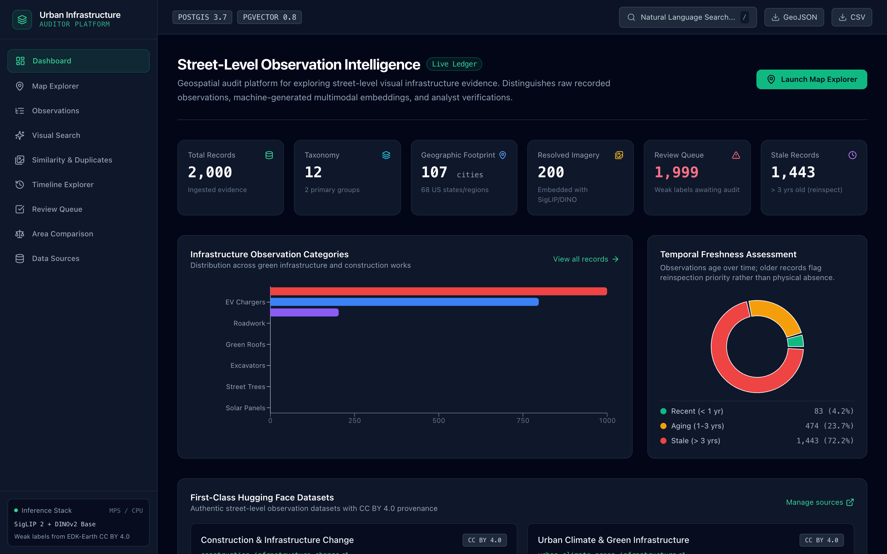
</p>

---

## 1. Product Vision & Core Distinction

`urban-infrastructure-auditor` is an enterprise geospatial observation ledger and visual intelligence platform designed for civil infrastructure auditors, smart-city engineers, urban planning agencies, and environmental analytics teams.

### The Core Architectural Distinction: Observations vs. Physical Assets

```
   +-------------------------------------------------------------+
   |                     HISTORICAL EVIDENCE                     |
   |  An observation confirms that a sensor captured an image    |
   |  showing features of infrastructure at a location & time.   |
   +------------------------------+------------------------------+
                                  |
                                  | DOES NOT AUTOMATICALLY PROVE
                                  v
   +-------------------------------------------------------------+
   |                      PHYSICAL REALITY                       |
   |  - Whether the infrastructure still exists today.           |
   |  - Whether the asset is currently operational.              |
   |  - Whether a construction project was completed.            |
   |  - Whether an unsampled area lacks infrastructure.          |
   +-------------------------------------------------------------+
```

1. **Weak Machine Labels**: The underlying Hugging Face datasets utilize query-driven embedding similarity to generate feature-level labels. They are **weak machine labels**, not verified ground truth.
2. **Preservation of Provenance**: Original feature labels are preserved immutably alongside human analyst verification.
3. **No Fabrication**: Missing imagery is handled transparently as metadata-only observations without fabricating visual evidence.
4. **Safety & Ethics**: No individual surveillance, facial recognition, or automatic deletion of records.

---

## 2. Visual Tour & Platform Features

### Interactive Geospatial Map (`/map`)

Interactive MapLibre GL visualization with PostGIS spatial clustering, bounding-box queries, and real-time inspector drawer.
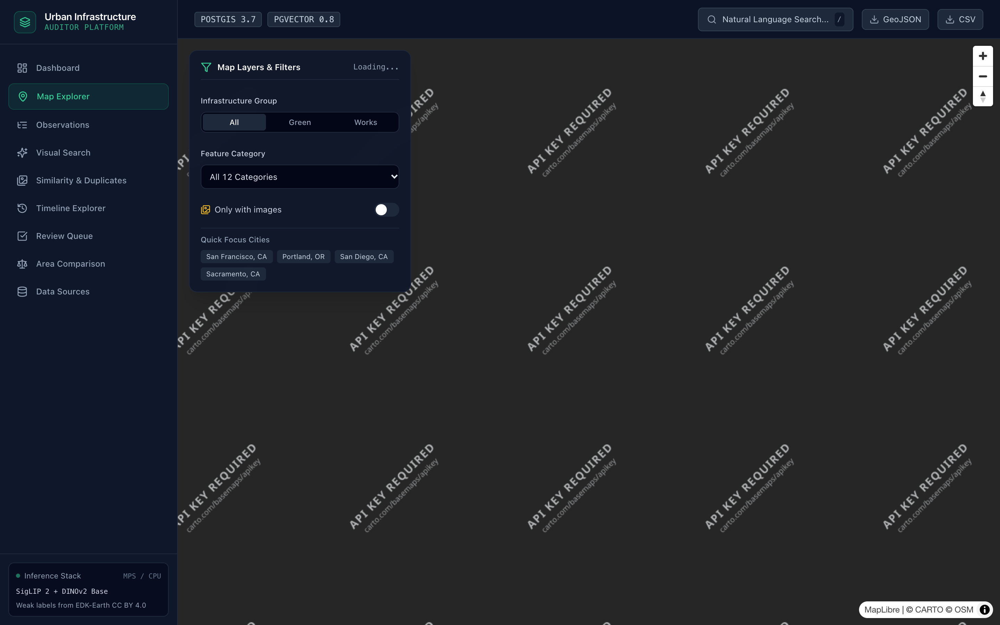

### Multimodal Semantic Search (`/visual-search`)

Natural language visual discovery powered by Google DeepMind SigLIP 2 cross-modal embeddings (768-d) and pgvector HNSW cosine indexing.
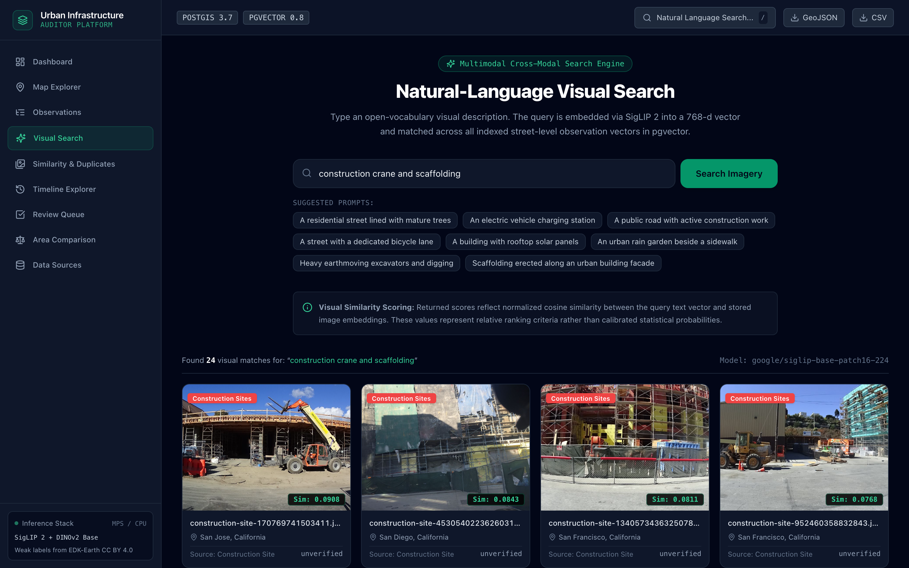

### DINOv2 Visual Similarity & Near-Duplicate Detection (`/similarity`)

Side-by-side comparison of candidate pairs discovered via Meta AI DINOv2 visual features, identifying near-duplicates (cosine > 0.90) and repeat observations.
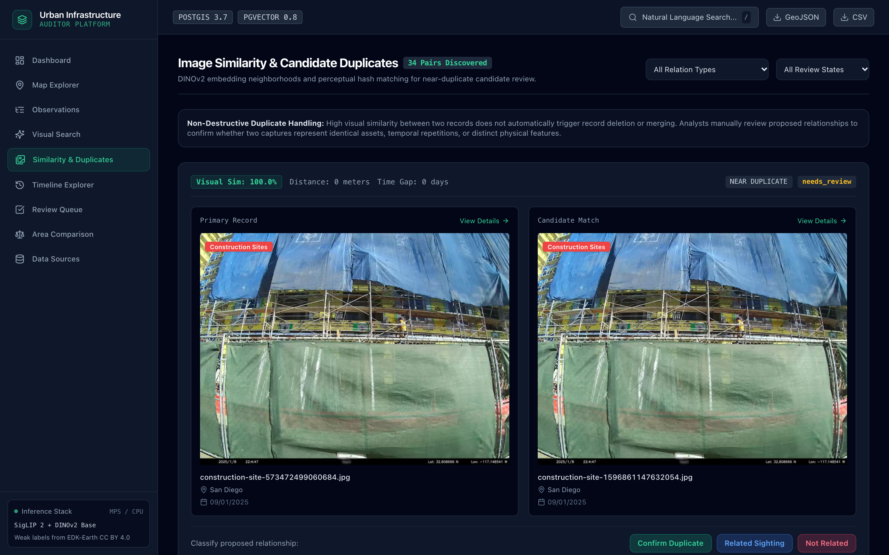

### Observation Detail & 5-Tab Inspector (`/observations/[id]`)

Deep-dive inspection covering observation provenance, vector specifications, PostGIS spatial neighbors, visual similarity candidates, and immutable audit events.
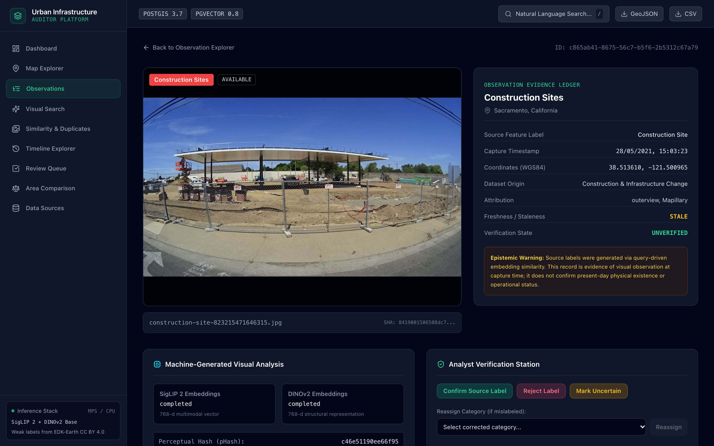

### Observation Catalog & Ledger (`/observations`)

Filterable, searchable catalog supporting multi-category queries, geographic filters, staleness tiers, and thumbnail inspection.
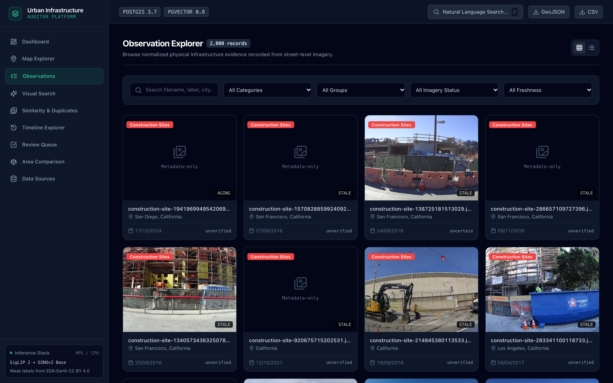

### Analyst Verification & Audit State Machine (`/review`)

Human-in-the-loop workflow allowing civil auditors to verify weak machine labels, reassign categories, mark ambiguous evidence, and track immutable audit logs.
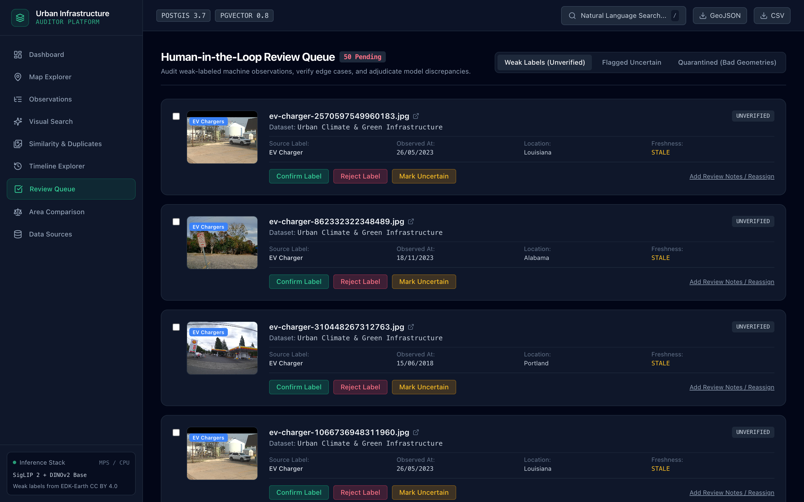

### Temporal Analysis & Staleness Tracking (`/timeline`)

Chronological frequency graphs and staleness stratification (Recent < 1yr, Aging 1-3yr, Stale > 3yr) to plan field reinspection campaigns.
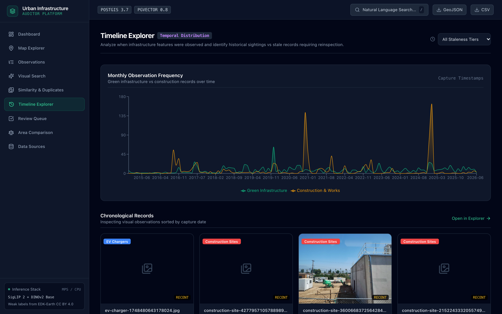

### Geographic Area Comparison (`/compare`)

Side-by-side comparative analysis of infrastructure distributions and density between two distinct geographic bounding boxes or jurisdictions.
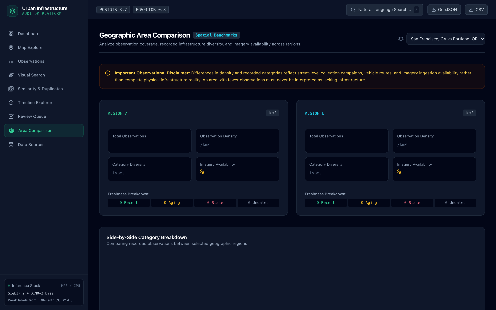

### Data Sources & License Provenance (`/data-sources`)

Dataset-level transparency detailing upstream Hugging Face repositories, Creative Commons CC BY 4.0 licenses, and ingestion job metrics.
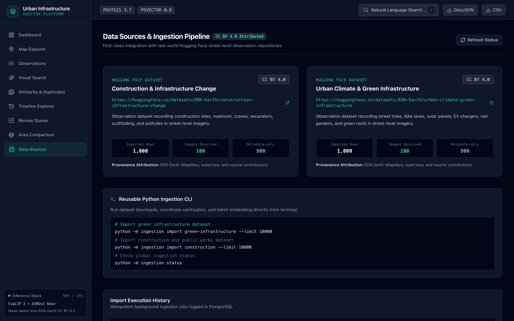

---

## 3. System Architecture

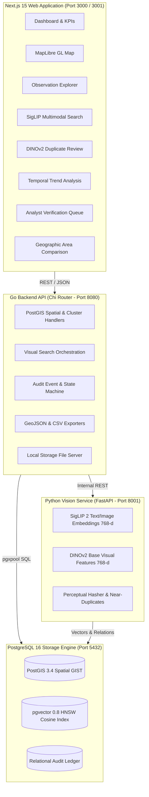

---

## 4. Computer Vision Pipeline

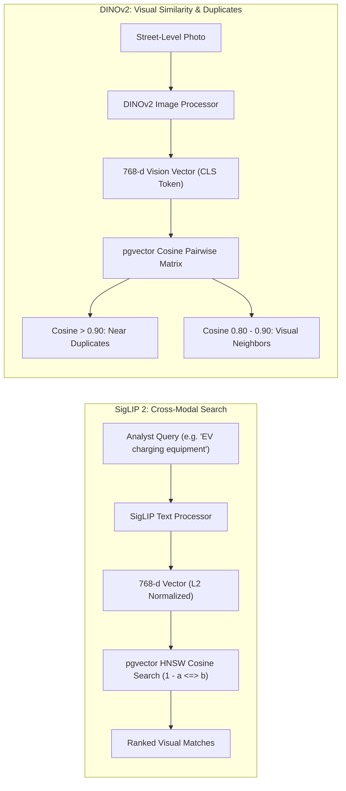

---

## 5. Observation Verification Lifecycle

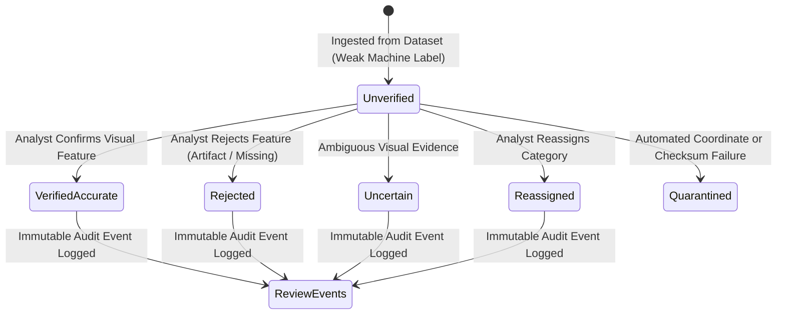

---

## 6. Technology Stack

- **Frontend**: Next.js 15 (App Router), React 19, TypeScript, Tailwind CSS, MapLibre GL JS 6, Recharts, TanStack Query, Lucide Icons.
- **Backend API**: Go 1.24, Chi router, `jackc/pgx/v5` connection pool, REST API, JSON schemas.
- **Computer Vision Service**: Python 3.11+, PyTorch (MPS / CPU), Hugging Face Transformers (`google/siglip-base-patch16-224`, `facebook/dinov2-base`), Pillow, NumPy, imagehash, FastAPI, Uvicorn.
- **Database & Geospatial**: PostgreSQL 16, PostGIS 3.4 (`geometry(Point, 4326)`), pgvector 0.8 (`vector(768)` with HNSW cosine distance indexes).
- **Storage**: S3-compatible local disk storage engine with path traversal protections.

---

## 7. Real-World Datasets

The platform is integrated with two real-world datasets published by **EDK-Earth** under **CC BY 4.0**:

1. **Construction & Infrastructure Change** (`EDK-Earth/construction-infrastructure-change`):
   - Categories: Construction Sites, Roadwork, Cranes, Excavators, Scaffolding, Potholes (~55,801 records).
2. **Urban Climate & Green Infrastructure** (`EDK-Earth/urban-climate-green-infrastructure`):
   - Categories: Street Trees, Bike Lanes, Solar Panels, EV Chargers, Rain Gardens, Green Roofs (~18,107 records).

---

## 8. Quickstart Guide

### Prerequisites

- Docker & Docker Compose **or** local Go 1.24+, Python 3.11+, Node.js 20+ (pnpm 10+), PostgreSQL 16 with PostGIS & pgvector.

### Option A: Complete Docker Setup

```bash
# Clone the repository
git clone https://github.com/ranajahanzaib/urban-infrastructure-auditor.git
cd urban-infrastructure-auditor

# Start all services (PostgreSQL + PostGIS + pgvector, Vision service, Go API, Next.js web)
docker compose up -d

# Open in browser:
# Web Frontend:  http://localhost:3000
# Go REST API:   http://localhost:8080/api/v1/health
# Vision API:    http://localhost:8001/health
```

### Option B: Local Development Setup

```bash
# 1. Start PostgreSQL with PostGIS & pgvector
docker compose up -d db

# 2. Setup Python environment and install dependencies
make setup

# 3. Apply database schema migrations
make migrate

# 4. Ingest real datasets (1,000 records per dataset with resolved street imagery)
make import

# 5. Extract SigLIP 2 and DINOv2 embeddings & discover candidate relations
make embed

# 6. Run the microservices:
# Terminal 1: Vision Microservice (FastAPI on Port 8001)
make run-vision

# Terminal 2: Go Backend API (Chi on Port 8080)
make run-api

# Terminal 3: Next.js Web Frontend (Port 3000 / 3001)
make run-web
```

---

## 9. Automated Testing & Verification

The platform includes full unit, integration, and end-to-end test suites covering all layers of the stack:

```bash
# Run all test suites
make test

# Or run individual suites:
make test-ingestion   # Coordinate validation, date parsing, taxonomy normalization
make test-vision      # SigLIP 2 & DINOv2 dimensions, L2 normalization, cosine similarity
make test-api         # Go API queries, pgvector search, PostGIS spatial clusters
make test-e2e         # Full stack E2E: DB + Vision (8001) + Go (8080) + Web
```

### Verified Test Results

| Test Suite       | Scope                     | Result         | Details                                                                 |
| :--------------- | :------------------------ | :------------- | :---------------------------------------------------------------------- |
| `test-ingestion` | Python Ingestion Pipeline | **PASS (8/8)** | Bounding-box validation, date normalizers, category mapping             |
| `test-vision`    | SigLIP 2 & DINOv2 Models  | **PASS (4/4)** | 768-d unit vectors, cosine similarity, model inference                  |
| `test-api`       | Go Backend & PostgreSQL   | **PASS (4/4)** | pgvector HNSW queries, PostGIS spatial clusters, relation matrices      |
| `test-e2e`       | Full Stack E2E System     | **PASS (9/9)** | API health, OpenAPI 3.0.3, visual search, review workflow, Web HTTP 200 |

---

## 10. Platform Views & API Routes

| View                         | Web Route            | API Endpoint                        | Primary Capability                                                                |
| :--------------------------- | :------------------- | :---------------------------------- | :-------------------------------------------------------------------------------- |
| **Executive Dashboard**      | `/`                  | `GET /api/v1/dashboard/summary`     | Real-time observation counts, staleness breakdown, category distributions.        |
| **Interactive Map**          | `/map`               | `GET /api/v1/geo/observations`      | MapLibre GL cluster view, bounding-box spatial filtering, inspection drawer.      |
| **Observation Ledger**       | `/observations`      | `GET /api/v1/observations`          | Paginated catalog, multi-category filters, provenance inspector.                  |
| **Observation Detail**       | `/observations/[id]` | `GET /api/v1/observations/{id}`     | 5-tab inspector: Provenance, Vector Specs, Spatial Neighbors, Similar, Audit Log. |
| **Multimodal Visual Search** | `/visual-search`     | `POST /api/v1/search/visual`        | Natural-language semantic search via SigLIP 2 cross-modal embeddings.             |
| **Similarity & Duplicates**  | `/similarity`        | `GET /api/v1/search/similar-groups` | DINOv2-driven candidate discovery and side-by-side comparison.                    |
| **Temporal Timeline**        | `/timeline`          | `GET /api/v1/dashboard/timeline`    | Multi-year chronological trends, seasonal rhythms, and reinspection queues.       |
| **Analyst Review**           | `/review`            | `POST /api/v1/reviews/{id}`         | Human verification queues (unverified, duplicates, uncertain, quarantined).       |
| **Geographic Comparison**    | `/compare`           | `POST /api/v1/geo/compare`          | Side-by-side infrastructure comparison of two geographic areas.                   |
| **Data Sources**             | `/data-sources`      | `GET /api/v1/datasets`              | Dataset provenance, CC BY 4.0 licenses, and ingestion status.                     |

---

## 11. Reproducing Screenshots

Showcase screenshots are generated directly from the live application using Playwright:

```bash
node scripts/capture_screenshots.mjs
```

Screenshots are saved in [`docs/screenshots/`](docs/screenshots/).

---

## 12. License & Attribution

- **Application Code**: Licensed under the [MIT License](LICENSE).
- **Datasets**: Published by EDK-Earth under [Creative Commons Attribution 4.0 International (CC BY 4.0)](https://creativecommons.org/licenses/by/4.0/). Contains imagery and metadata from Mapillary and civic contributors.
- **Models**:
  - `google/siglip-base-patch16-224` (Google DeepMind, Apache 2.0).
  - `facebook/dinov2-base` (Meta AI, Apache 2.0).
- Detailed attribution is documented in [docs/ATTRIBUTION.md](docs/ATTRIBUTION.md).
