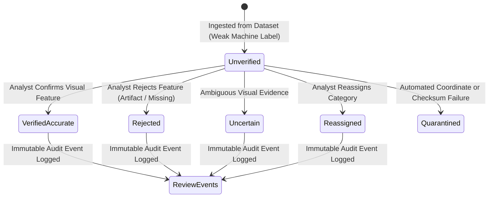

# Urban Infrastructure Auditor (`urban-infrastructure-auditor`)

> **Street-Level Infrastructure Intelligence Platform**  
> Combining street-level imagery, multimodal computer vision embeddings (SigLIP 2 & DINOv2), spatial analysis (PostGIS), temporal change detection, and human verification.

[](LICENSE)
[](https://nextjs.org/)
[](https://golang.org)
[](https://postgis.net/)
[](https://github.com/pgvector/pgvector)
[](https://pytorch.org/)
[](https://huggingface.co/)

---

## 1. Product Vision & Core Distinction

`urban-infrastructure-auditor` is an enterprise geospatial observation ledger and visual intelligence platform designed for civil infrastructure auditors, smart-city engineers, urban planning agencies, and environmental analytics teams.

### The Core Architectural Distinction: Observations vs. Physical Assets

```
   +-------------------------------------------------------------+
   |                     HISTORICAL EVIDENCE                     |
   |  An observation confirms that a sensor captured an image    |
   |  showing features of infrastructure at a location & time.   |
   +------------------------------+------------------------------+
                                  |
                                  | DOES NOT AUTOMATICALLY PROVE
                                  v
   +-------------------------------------------------------------+
   |                      PHYSICAL REALITY                       |
   |  - Whether the infrastructure still exists today.           |
   |  - Whether the asset is currently operational.              |
   |  - Whether a construction project was completed.            |
   |  - Whether an unsampled area lacks infrastructure.          |
   +-------------------------------------------------------------+
```

1. **Weak Machine Labels**: The underlying Hugging Face datasets utilize query-driven embedding similarity to generate feature-level labels. They are **weak machine labels**, not verified ground truth.
2. **Preservation of Provenance**: Original feature labels are preserved immutably alongside human analyst verification.
3. **No Fabrication**: Missing imagery is handled transparently as metadata-only observations without fabricating visual evidence.
4. **Safety & Ethics**: No individual surveillance, facial recognition, or automatic deletion of records.

---

## 2. System Architecture


---

## 3. Computer Vision Pipeline


---

## 4. Observation Verification Lifecycle



---

## 5. Technology Stack

- **Frontend**: Next.js 15 (App Router), React 19, TypeScript, Tailwind CSS, MapLibre GL JS, Recharts, TanStack Query, Lucide Icons.
- **Backend**: Go 1.24, Chi router, pgx/v5 connection pool, REST API, JSON schemas.
- **Computer Vision**: Python 3.11+, PyTorch, Hugging Face Transformers (`google/siglip-base-patch16-224`, `facebook/dinov2-base`), Pillow, NumPy, imagehash.
- **Database & Geospatial**: PostgreSQL 16, PostGIS 3.4 (`geometry(Point, 4326)`), pgvector 0.8 (`vector(768)` with HNSW cosine indexes).
- **Storage**: S3-compatible local disk storage engine with path traversal protections.

---

## 6. Real-World Datasets

The platform is integrated with two real-world datasets published by **EDK-Earth** under **CC BY 4.0**:

1. **Construction & Infrastructure Change** (`EDK-Earth/construction-infrastructure-change`):
   - Categories: Construction Sites, Roadwork, Cranes, Excavators, Scaffolding, Potholes (~55,801 records).
2. **Urban Climate & Green Infrastructure** (`EDK-Earth/urban-climate-green-infrastructure`):
   - Categories: Street Trees, Bike Lanes, Solar Panels, EV Chargers, Rain Gardens, Green Roofs (~18,107 records).

---

## 7. Quickstart Guide

### Prerequisites

- Docker & Docker Compose **or** local Go 1.24, Python 3.11+, Node.js 20+ (pnpm 10+), PostgreSQL 16 with PostGIS & pgvector.

### Option A: Complete Docker Setup

```bash
# Clone the repository
git clone https://github.com/ranajahanzaib/urban-infrastructure-auditor.git
cd urban-infrastructure-auditor

# Start all services (Database, Vision microservice, Go API, Web frontend)
docker compose up -d

# Open in browser:
# Web Frontend:  http://localhost:3000
# Go REST API:   http://localhost:8080/api/v1/health
# Vision API:    http://localhost:8001/health
```

### Option B: Local Development Setup

```bash
# 1. Start PostgreSQL with PostGIS & pgvector
docker compose up -d db

# 2. Setup Python environment and install dependencies
make setup

# 3. Apply database migrations
make migrate

# 4. Ingest real datasets (5,000 records each with resolved images)
make import

# 5. Extract SigLIP and DINOv2 embeddings & relations
make embed

# 6. Run the services in separate terminals:
# Terminal 1: Vision Microservice
make run-vision
# Terminal 2: Go Backend API
make run-api
# Terminal 3: Next.js Frontend
make run-web
```

---

## 8. Automated Testing

The platform includes full unit, integration, and end-to-end test suites:

```bash
# Run all test suites
make test

# Or run individual suites:
make test-ingestion   # Coordinate validation, date parsing, taxonomy normalization
make test-vision      # SigLIP & DINOv2 dimensions, L2 normalization, cosine similarity
make test-api         # Go API queries, pgvector search, PostGIS spatial clusters
make test-e2e         # Full stack E2E: DB + Vision (8001) + Go (8080) + Web (3000)
```

---

## 9. Platform Views & Features

| View                         | Route                | Primary Capability                                                                |
| ---------------------------- | -------------------- | --------------------------------------------------------------------------------- |
| **Executive Dashboard**      | `/`                  | Real-time observation counts, staleness breakdown, category distributions.        |
| **Interactive Map**          | `/map`               | MapLibre GL cluster view, bounding-box spatial filtering, inspection drawer.      |
| **Observation Ledger**       | `/observations`      | Paginated catalog, multi-category filters, provenance inspector.                  |
| **Observation Detail**       | `/observations/[id]` | 5-tab inspector: Provenance, Vector Specs, Spatial Neighbors, Similar, Audit Log. |
| **Multimodal Visual Search** | `/visual-search`     | Natural-language semantic search via SigLIP 2 cross-modal embeddings.             |
| **Similarity & Duplicates**  | `/similarity`        | DINOv2-driven candidate discovery and side-by-side comparison.                    |
| **Temporal Timeline**        | `/timeline`          | Multi-year chronological trends, seasonal rhythms, and reinspection queues.       |
| **Analyst Review**           | `/review`            | Human verification queues (unverified, duplicates, uncertain, quarantined).       |
| **Geographic Comparison**    | `/compare`           | Side-by-side infrastructure comparison of two geographic areas.                   |
| **Data Sources**             | `/data-sources`      | Dataset provenance, CC BY 4.0 licenses, and ingestion status.                     |

---

## 10. License & Attribution

- **Application Code**: Licensed under the [MIT License](LICENSE).
- **Datasets**: Published by EDK-Earth under [Creative Commons Attribution 4.0 International (CC BY 4.0)](https://creativecommons.org/licenses/by/4.0/). Contains imagery and metadata from Mapillary and civic contributors.
- **Models**:
  - `google/siglip-base-patch16-224` (Google DeepMind, Apache 2.0).
  - `facebook/dinov2-base` (Meta AI, Apache 2.0).
- Detailed attribution is documented in [docs/ATTRIBUTION.md](docs/ATTRIBUTION.md).
