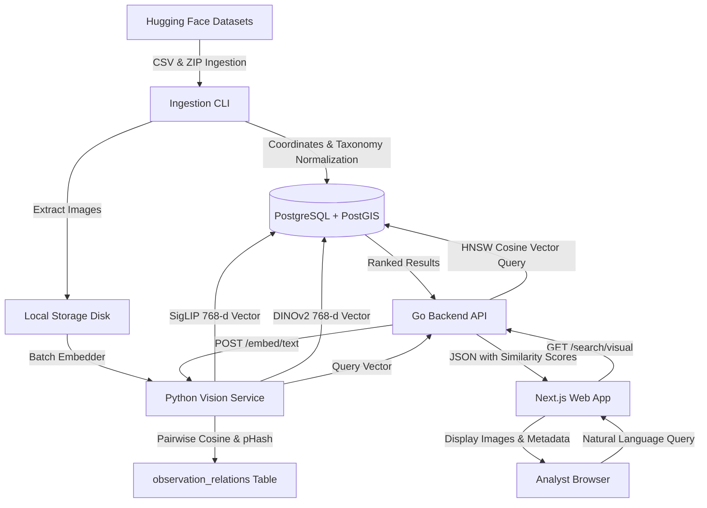

# System Architecture: Urban Infrastructure Auditor

## 1. System Overview

**Urban Infrastructure Auditor** is an enterprise-grade geospatial observation ledger and visual intelligence platform designed for municipal planning organizations, geospatial technology companies, smart-city researchers, and civil engineering auditors.

The system combines street-level imagery, multimodal computer vision embeddings, spatial analysis, temporal change tracking, and human-in-the-loop review.

```
+---------------------------------------------------------------------------------------+
|                                    Next.js 15 Web App                                 |
|         (MapLibre GL, TanStack Query, Recharts, Tailwind CSS, Lucide Icons)           |
+------------------------------------------+--------------------------------------------+
                                           | HTTP / JSON REST
                                           v
+---------------------------------------------------------------------------------------+
|                                  Go Backend API (Chi)                                 |
|               (Spatial Queries, Observability, Reviews, Image Serving)                |
+---------------------+-----------------------------------+-----------------------------+
                      |                                   |
         Internal HTTP|                                   | SQL (pgxpool)
                      v                                   v
+-----------------------------+           +---------------------------------------------+
|    Python Vision Service    |           |          PostgreSQL 16 Database             |
|          (FastAPI)          |           |   - PostGIS 3.4 (Spatial indexing & math)   |
| - SigLIP 2 (Cross-Modal)    |           |   - pgvector 0.8 (HNSW 768-d Cosine index)  |
| - DINOv2 (Visual Similarity)|           |   - Relational observation & review ledger  |
+-----------------------------+           +---------------------------------------------+
              |                                                   |
              +----------------- Local Image Storage -------------+
                            (/data/storage/images)
```

---

## 2. Fundamental Architectural Principle: Observation vs. Fact

The platform enforces a strict separation between **historical observations** and **physical reality**:

1. **Observations are historical visual evidence**: An observation records that a sensor captured an image showing features of infrastructure at a specific latitude, longitude, and timestamp.
2. **Observations do not establish existence**: An observation of a street tree in 2018 does not prove the tree exists today.
3. **Observations do not establish operational status**: An observed EV charging station may be decommissioned, broken, or privately restricted.
4. **Absence of evidence is not evidence of absence**: Areas lacking observations have simply not been surveyed or sampled; they do not lack infrastructure.
5. **Labels are weak predictions**: The Hugging Face EDK-Earth datasets use query-driven embedding similarity to assign feature labels. They are **weak machine labels**, not expert ground truth.

---

## 3. Subsystem Breakdown

### A. Frontend Layer (`apps/web`)

- **Framework**: Next.js 15 with App Router, React 19, TypeScript strict mode.
- **Mapping**: MapLibre GL JS with free OpenStreetMap/Carto basemaps (no proprietary tokens required).
- **Visualization**: Recharts for temporal distributions, category ratios, and geographic comparisons.
- **Server State**: TanStack Query (React Query) for caching, optimistic updates, and invalidation.
- **UI Components**: Modern dark-slate UI built with Tailwind CSS, custom cards, modal inspectors, and accessible drawer components.

### B. Backend API Layer (`services/api`)

- **Language**: Go 1.24+ with Chi lightweight HTTP router.
- **Database Driver**: `pgx/v5` with high-concurrency connection pooling (`pgxpool`).
- **Geospatial Processing**: PostGIS spatial queries, bounding-box envelopes, grid-based spatial clustering (`ST_SnapToGrid`), and k-nearest neighbors (`<->`).
- **Storage**: S3-compatible local disk storage engine with path traversal protections (`filepath.Clean`, `os.DirFS`).
- **Human Review Ledger**: ACID transactions for state transitions (`unverified` -> `verified_accurate`, `rejected`, `uncertain`), preserving immutable audit event rows in `review_events`.

### C. Computer Vision Layer (`services/vision`)

- **Framework**: Python 3.11+, FastAPI, PyTorch, Hugging Face Transformers.
- **Dual Model Architecture**:
  1. **SigLIP 2 (`google/siglip-base-patch16-224`)**: 768-dimensional multimodal vision-language model. Handles text-to-image queries, zero-shot open-vocabulary search, and natural language ranking.
  2. **DINOv2 Base (`facebook/dinov2-base`)**: 768-dimensional self-supervised vision transformer. Handles image-to-image similarity, visual neighborhood discovery, and duplicate candidate generation.
- **Decoupled Deployment**: Runs independently on port 8001. Go API interacts via asynchronous or synchronous REST endpoints. If the vision microservice fails or restarts, geospatial queries and metadata remain 100% operational.

### D. Geospatial & Vector Database Layer

- **PostgreSQL 16**: Standard relational integrity with foreign keys, checks, and timestamps.
- **PostGIS 3.4**: `geometry(Point, 4326)` for EPSG:4326 coordinates, GIST spatial indexes for sub-millisecond bounding box and range queries.
- **pgvector 0.8**: `vector(768)` columns with HNSW cosine indexes (`m=16`, `ef_construction=64`) for lightning-fast approximate nearest neighbor visual searches.

---

## 4. Data Flow


